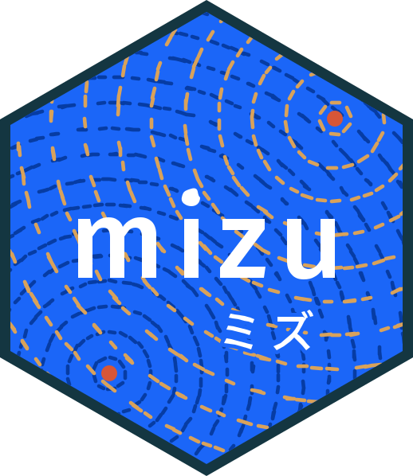

<!-- README.md is generated from README.Rmd. Please edit that file -->

# mizu <a href="https://shikokuchuo.net/mizu/" alt="mizu"></a>

<!-- badges: start -->

[](https://github.com/shikokuchuo/mizu/actions/workflows/R-CMD-check.yaml)
[](https://app.codecov.io/gh/shikokuchuo/mizu)
[](https://lifecycle.r-lib.org/articles/stages.html#experimental)
[](LICENSE.md)
<!-- badges: end -->

Async and parallel R at thread speed over shared memory.

A task round trip drops from ~100 µs over sockets to \< 1 µs, so you can divide work as finely as you would with threads (see [Benchmarks](#benchmarks)). Common data structures like vectors, matrices, data frames, and Arrow tables can be shared between R and Python as zero-copy views.

Channels and work-stealing task pools run over POSIX shared memory (Linux, macOS) or Win32 file mappings (Windows): lock-free single-producer single-consumer rings with batched publication, spin-then-park waiting that stays out of the kernel on the hot path, and OS notification when a peer dies.

mizu is built on [libmizu](https://github.com/shikokuchuo/libmizu), a C library for lock-free shared-memory IPC.
[pymizu](https://github.com/shikokuchuo/pymizu) binds the same core for Python, so R and Python can talk to each other.

- Zero-copy vectors and data frames — received as ALTREP views over the shared pages
- Zero-copy Arrow interchange — `arrow` tables and record batches travel as one frame and convert back without copying
- Event-driven async — messages stream into a `later` event loop without polling, and channels, tasks, and maps plug into `promises` pipelines, ready for Shiny
- Reproducible parallel random numbers (`.seed`) — identical results for any worker count or steal order
- Nested parallel maps — a task can map over its own pool, deadlock-free

> **Lifecycle: experimental.** The API is not yet stable and we may make changes in response to feedback.

## Installation

Install the development version from GitHub:

``` r
pak::pak("shikokuchuo/mizu")
```

Requires R 4.3 or later.

## Quickstart

``` r
library(mizu)

p <- mizu_pool(n_workers = 4L)

t <- mizu_submit(p, sum(x) + y, x = 1:10, y = 100)
mizu_collect(t)
#> [1] 155

mizu_pool_stop(p)
```

## Benchmarks

Communication overhead against mirai on one machine (M4 Pro, from `dev/bench/mizu-mirai-bench.R`):

| Benchmark | mizu | mirai | Speedup |
|----|----|----|----|
| Trivial task round trip | 0.8 µs | 100.5 µs | 126x |
| Pipelined throughput, 1 worker | 833,000 tasks/s | 9,700 tasks/s | 86x |
| 8 MB vector round trip | 400 µs | 18.4 ms | 46x |
| Parallel map of 2,000 ~10 µs tasks, 4 workers | 5.0 ms | 218 ms | 44x |

Note: mirai also serves workers on remote machines and HPC clusters, which shared memory cannot reach.

## Parallel map

`mizu_map()` maps a function over a vector or list on the pool and returns a map handle immediately, just as `mizu_submit()` returns a task. `mizu_collect()` on the handle waits and returns the results in order.
The function and data cross into shared memory once.
Workers divide the elements among themselves, claiming ranges from a shared cursor.

A map also nests: the mapped function can map over its own pool with `mizu_map(mizu_current_pool(), ...)`, deadlock-free.

``` r
p <- mizu_pool(n_workers = 4L)

m <- mizu_map(p, 1:5, \(i) i * 2L, .template = integer(1))
mizu_collect(m)
#> [1]  2  4  6  8 10

parts <- split(as.numeric(1:100000), rep(1:4, each = 25000))
m <- mizu_map(p, parts, \(part) {
  nested <- mizu_map(mizu_current_pool(), part, sqrt, .template = numeric(1))
  sum(mizu_collect(nested))
}, .template = numeric(1))
mizu_collect(m)
#>       1       2       3       4 
#> 2635310 4818361 6239529 7388808

mizu_pool_stop(p)
```

## Python interop

Pool workers can be Python processes that run [pymizu](https://github.com/shikokuchuo/pymizu), the Python binding of the same core.
`mizu_py_launcher()` spawns them and `mizu_call()` specifies the task. Here, R’s built-in `mtcars` is summarized by polars in Python:

``` r
p <- mizu_pool(n_workers = 4L, launcher = mizu_py_launcher())

t <- mizu_submit_call(
  p,
  mizu_call(
    .source = r"(import polars as pl
pl.DataFrame(x).group_by('cyl').agg(pl.col('mpg').mean()).sort('cyl'))",
    x = mtcars
  )
)
mizu_collect(t)
#>   cyl      mpg
#> 1   4 26.66364
#> 2   6 19.74286
#> 3   8 15.10000

mizu_pool_stop(p)
```

- A numeric vector arrives in Python as a NumPy array, and a data frame as a `pymizu.Frame`
- A NumPy array, or a polars, pyarrow, or pandas frame, arrives back as a vector or data frame
- Arrow data (`arrow` tables and record batches, or any struct-typed `nanoarrow_array_stream`) crosses the same way

The pymizu README shows the reverse direction: a Python host that drives R workers with `pymizu.r_launcher()`.

## Vignettes

`vignette("mizu", package = "mizu")` is the main overview.
Topic vignettes cover benchmarks, channels, task pools, the parallel map, Python interop, and operations (Linux memory tuning and crash semantics).
The [pkgdown site](https://shikokuchuo.net/mizu/) has the function reference and the rendered vignettes.

------------------------------------------------------------------------

Please note that this project is released with a [Contributor Code of Conduct](https://github.com/shikokuchuo/mizu/blob/main/.github/CODE_OF_CONDUCT.md). By participating in this project you agree to abide by its terms.
